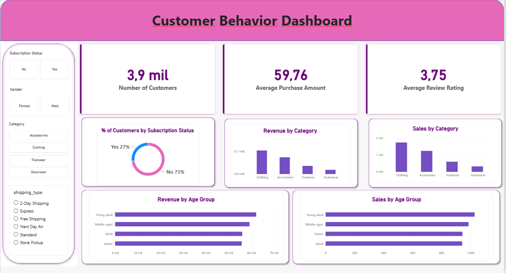

# Customer Shopping Behavior Analysis

### End-to-End Data Analytics Project | Python · PostgreSQL · Power BI

An end-to-end analysis of customer shopping behavior, from data preparation in Python to business-focused SQL queries and an interactive Power BI report. The project uses **3,900 shopping records** to explore customer segments, purchasing patterns, revenue, discounts, subscriptions, and product performance.

## Dashboard Preview



The dashboard includes filters for **subscription status, gender, product category, and shipping type**.

## Key Metrics

| Metric | Value |
|---|---:|
| Customer records | 3,900 |
| Average purchase amount | $59.76 |
| Average review rating | 3.75 |
| Subscribed customers | 27% |
| Non-subscribed customers | 73% |

*Values are displayed as shown in the dashboard; percentages are rounded. Purchase amounts are denominated in USD in the source dataset.*

## Business Questions

The PostgreSQL analysis addresses ten questions:

1. How much revenue is generated by male versus female customers?
2. Which customers used a discount but still spent at least the average purchase amount?
3. Which five products have the highest average review rating?
4. How does average spending compare between Standard and Express shipping?
5. Do subscribed customers spend more than non-subscribers?
6. Which five products have the highest share of discounted purchases?
7. How many customers are classified as New, Returning, or Loyal based on previous purchases?
8. Which three products are purchased most frequently within each category?
9. How are repeat buyers (more than five previous purchases) distributed by subscription status?
10. How much revenue does each age group contribute?

The queries demonstrate **aggregations, subqueries, CASE expressions, common table expressions (CTEs), and window functions**.

## Workflow

**CSV dataset → Python (EDA, cleaning, feature engineering) → PostgreSQL (customer table) → SQL analysis → Power BI dashboard**

### 1. Python: Data Preparation

The notebook explores the dataset, checks missing values, fills missing review ratings using category-level medians, standardizes column names, creates an `age_group` variable, maps purchase frequency into approximate days, and removes the redundant `promo_code_used` column after checking its relationship with `discount_applied`.

### 2. PostgreSQL: Business Analysis

The cleaned data is stored in the `customer_behavior` database, in a table named `customer`. The SQL script contains ten queries covering revenue, products, subscriptions, discounts, shipping, and customer segmentation.

### 3. Power BI: Interactive Reporting

The dashboard presents customer count, average purchase amount, average review rating, subscription distribution, and comparisons of revenue and sales by category and age group.

**Dashboard observations:** Clothing leads the displayed category comparisons, and Young Adult leads the age-group comparisons. These are descriptive patterns, not causal findings.

## Tools and Skills

| Tool | Purpose |
|---|---|
| Python / pandas | Data exploration, cleaning, and feature engineering |
| SQLAlchemy / psycopg2 | PostgreSQL connectivity and data loading |
| PostgreSQL / pgAdmin | Relational storage and SQL analysis |
| Power BI / Power Query | Interactive visualization and reporting |
| Jupyter Notebook | Reproducible analysis workflow |

## Repository Structure

```text
customer-shopping-behavior-analysis/
├── data/
│   └── customer_shopping_behavior.csv
├── notebooks/
│   └── Customer_Behavoir_Analysis.ipynb
├── sql/
│   └── customer_behavior_analysis_sql_queries.sql
├── dashboard/
│   ├── customer_behavior_dashboard.pbix
│   └── dashboard_preview.png
├── .env.example
├── .gitignore
├── requirements.txt
└── README.md
```

## How to Reproduce

**Prerequisites:** Python, PostgreSQL, and (to open the dashboard) Power BI Desktop.

1. Download or clone this repository and install the Python dependencies:

   ```bash
   pip install -r requirements.txt
   ```

2. Create a PostgreSQL database named `customer_behavior` and copy `.env.example` to `.env` in the repository root. Update `.env` with your own local credentials:

   ```dotenv
   DB_USER=postgres
   DB_PASSWORD=your_local_password
   DB_HOST=localhost
   DB_PORT=5432
   DB_NAME=customer_behavior
   ```

3. Open `notebooks/Customer_Behavoir_Analysis.ipynb` and run the data preparation cells. The notebook loads `data/customer_shopping_behavior.csv`.

4. To initialize a **new or disposable** database, enable the notebook's optional upload step (`UPLOAD_TO_POSTGRESQL = True`) after checking that the cleaned DataFrame is ready. **Warning:** if the upload uses `if_exists="replace"`, it will replace an existing `customer` table. Leave upload disabled when working with an existing table.

5. Run the statements in `sql/customer_behavior_analysis_sql_queries.sql` against `customer_behavior` using pgAdmin or another PostgreSQL client.

6. Open `dashboard/customer_behavior_dashboard.pbix` in Power BI Desktop. If you want to refresh the data, configure its PostgreSQL connection to your own database. The report preview can be viewed above without installing Power BI.

> **Security:** The real `.env` file must never be uploaded. `.env.example` contains placeholders only. Credentials are managed locally rather than hard-coded in the notebook or SQL files. When uploading through the GitHub website, manually exclude `.env` and checkpoint folders.

## Notes and Limitations

- This is a descriptive analysis of the provided customer shopping dataset, not a causal study.
- The Power BI file uses a local PostgreSQL connection; anyone refreshing it must configure their own database and credentials.
- SQL results and dashboard values reflect the available data and the selected filters.

## Project Files

- [Python notebook](notebooks/Customer_Behavoir_Analysis.ipynb)
- [SQL queries](sql/customer_behavior_analysis_sql_queries.sql)
- [Power BI report](dashboard/customer_behavior_dashboard.pbix)
- [Dashboard preview](dashboard/dashboard_preview.png)
- [Dataset](data/customer_shopping_behavior.csv)
